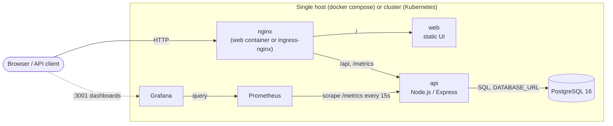

# TaskBoard architecture

TaskBoard is deliberately a small application wrapped in a complete,
production-shaped delivery system. This document describes how the pieces
fit together.

## System diagram

## Request flow

1. The browser loads the static UI from the **web** service.
2. The UI calls the API with relative URLs (`/api/tasks`). In the compose
   stack, the web container's nginx proxies `/api/` and `/metrics` to the
   **api** service; in Kubernetes the **ingress** performs the same routing
   (the web service only serves static files there).
3. The API reads/writes tasks through its store layer:
   - `DATABASE_URL` set → **PostgresStore** (table auto-created on boot).
   - Otherwise → **MemoryStore** (used by tests and quick local runs).
4. Prometheus scrapes `GET /metrics` on the API (request counter
   `http_requests_total`, latency histogram `http_request_duration_seconds`,
   plus Node.js/process defaults). Grafana renders the provisioned
   "TaskBoard API" dashboard from that data.

## Components

| Component   | Tech                | Responsibility                                        |
| ----------- | ------------------- | ----------------------------------------------------- |
| `app/`      | Node.js 20, Express | REST API, health + metrics endpoints, graceful shutdown |
| `web/`      | nginx               | Static UI + reverse proxy (compose mode)              |
| `db`        | PostgreSQL 16       | Durable task storage (compose volume `pgdata`)        |
| Prometheus  | prom/prometheus     | Metrics collection                                    |
| Grafana     | grafana/grafana     | Provisioned datasource + dashboard                    |
| `k8s/`      | Raw manifests       | Namespace, workloads, ingress, HPA (kustomize-ready)  |
| `helm/`     | Helm chart          | The same workloads, parameterized                     |
| `terraform/`| AWS provider        | VPC, subnet, SG, EC2 host + Elastic IP                |
| `ansible/`  | Ansible playbook    | Idempotent host configuration                       |

## Environments

There is one codebase and three ways to run it:

- **Local / CI** — `npm test` runs the API against the in-memory store on
  an ephemeral port; no infrastructure required.
- **Single host** — `docker compose up` (laptop, or the EC2 instance from
  `terraform/`, configured by `ansible/` and updated by
  `scripts/deploy.sh`).
- **Kubernetes** — raw manifests (`kubectl apply -k k8s/`) or Helm
  (`helm install taskboard helm/taskboard`). A managed Postgres (or any
  `DATABASE_URL`) is injected via a Secret; the chart accepts
  `api.existingSecret`.

## Scaling & reliability notes

- The API is stateless when backed by Postgres, so it scales horizontally:
  2 replicas by default, HPA to 6 at 70% CPU. Rolling updates use
  `maxUnavailable: 0`; the app handles SIGTERM by draining connections.
- `/health` drives Docker HEALTHCHECKs, compose `depends_on` ordering,
  and Kubernetes liveness/readiness probes — one contract, three systems.
- Resource requests/limits are set on every workload so the HPA has a
  meaningful utilization baseline.
- Known limits of this demo shape: single-node Postgres in compose (no
  backups/replication), no TLS termination configured, and Grafana/
  Prometheus on the EC2 host are restricted by security group to an admin
  CIDR rather than sitting behind auth-aware proxying.
